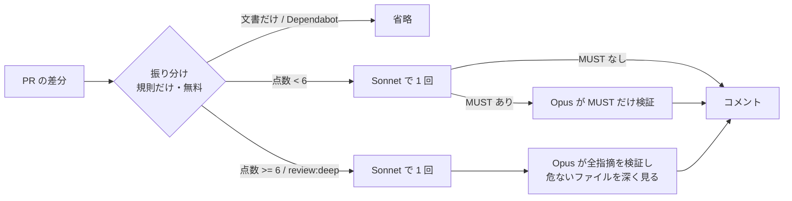

# auto-review

PR の差分を **危なさで振り分け**、ふだんは中位のモデル（Sonnet）で 1 回だけレビューし、
**危ない変更と、Sonnet が MUST を出したときだけ** 上位のモデル（Opus）を足す仕組みです。

「全部の PR を全部のモデルで見る」のではなく、「必要なときだけ Opus」を規則で自動化します。

## 考え方: マルチモデルのレビューは実務でありか

結論: **「全モデルで毎回」はなし。「ふだん 1 モデル + 必要なときだけ上位モデルが検証」はあり。**

### 費用はトークンより「人が読む件数」で決まる

PR 単位の実験（[results/2026-10-04-auto-review](../results/2026-10-04-auto-review/README.md)、11 PR）の 1 PR あたりの費用は次のとおりです。

| 構成 | 1 PR あたり | 月 150 PR なら |
|---|---|---|
| Sonnet だけ | 約 $0.03 | 約 $4 |
| Opus だけ | 約 $0.07 | 約 $10 |
| auto（この仕組み。実験の PR は 8 割に弱いところを仕込んだので、Opus に上がりやすい条件） | 約 $0.06 | 実際の PR は MUST が少ないので、$5〜6 程度の見込み |

GitHub Copilot は 2026 年 6 月から、モデルの公開価格に沿ったトークン課金（AI Credits）になりました。
Business は 1 人あたり月 $19 分のクレジットが付き、組織で共有できます。**PR のレビューに使う量は、この枠に比べて小さい** です。

Copilot の費用が膨らむのは、レビューではなく **Opus をエージェントモードで長く使うとき** です。
エージェントは 1 回の作業で何十回もモデルを呼び、そのたびにファイルや会話を送り直すためです。
たとえば 1 回 8 万トークンの入力を 30 回送ると 240 万トークンで、Opus の単価（$4 / 100 万トークン）では入力だけで約 $10 になります（キャッシュが効けばもっと安い）。
対策は、モデルの既定を Sonnet にし、Opus は「検証」のように範囲を絞った使い方に限ることです。

### 品質: PR 単位なら Sonnet で十分。Opus の役目は「検証」

| 分かったこと | 根拠 |
|---|---|
| PR 単位の差分なら、どのモデルも仕込んだ弱いところを 8 件とも見つけた | 差分に問題が集中しているため。リポジトリ全体のレビューでは Haiku は 1 / 8 しか見つけられなかった（[前回の実験](../results/2026-10-04-model-compare/README.md)） |
| モデルの差は「正解以外の MUST」に出た（Haiku 4、Sonnet 2、Opus 1、auto 1） | 人が確かめる手間は、この誤った MUST で増える |
| auto は Opus と同じ精度（正解以外の MUST 1）を、Opus に毎回回すより安く出した | Opus を呼んだのは 11 PR 中 7 回で、範囲は Sonnet の MUST と危ないファイルだけ |
| 何も問題の無い PR（3 件）で、どの構成も MUST・WANT を出さなかった | 文書だけの PR は auto が省いた（費用 0） |

### 3 回ずつ流した結果と、誤った MUST の扱い（[2 回目の実験](../results/2026-10-04-auto-review-repeat/README.md)）

- 3 回とも、どの構成も仕込んだ弱いところを全部見つけた（24 / 24）
- 危なそうに見えるが正しい「おとり」の PR で、Sonnet だけだと 15 回中 3 回、推測に基づく誤った MUST が出た。auto では Opus がそれを「却下」か「要確認」に振り分け、**「検証済み」として見せた誤りは 0 件**
- auto の費用は「MUST が出る PR の割合」で決まる（Sonnet だけで終われば $0.009、Opus の検証まで進むと $0.083）。割合が 2 割なら 1 PR あたり約 $0.024、Opus だけ（$0.044）の約半分。MUST が多いチームでは Opus だけのほうが安い

### 複数のモデルを「並べて」使わない理由

前回の実験では、3 モデルの指摘を合わせると 45 件（Opus だけなら 19 件）で、検出は Opus だけと同じでした。
**指摘の和を人に見せると、確かめる件数が 2 倍以上になって検出は増えない**。
そこで auto では、2 つ目のモデルを「別の指摘を足す役」ではなく **「一次の指摘を認める・却下する役」** にしています。
却下した指摘は折りたたんで見せるので、人が読む件数は増えません。

## 流れ



- **振り分けはモデルを使わない**（[router.yaml](src/auto_review/router.yaml) の規則で点数を付ける）。費用がかからず、毎回同じ結果で、「なぜ Opus に回ったか」を説明できる
  - 点数の例: SQL の Mapper +3、Service +2、例外ハンドラ +2、`@Transactional` の変更 +2、テストを消した・減らした +3、変更が 400 行以上 +2
- **予算**: 1 PR あたりの上限（既定 $1）を見積もりで確かめ、超えそうなら Opus の範囲を危ないファイル 3 つに絞る。それでも超えるなら Opus を飛ばして理由をコメントに書く。月の上限は API 側（ワークスペースの上限、Copilot なら組織・利用者ごとの予算）で掛ける
- **ラベル**: `review:deep`（必ず Opus まで）、`review:standard`（Opus に上げない）、`review:skip`（省く）
- **追加の push** では前回からの差分だけを見る（同じ箇所に何度も費用をかけない）

## 使い方

```bash
pip install -e auto-review                    # このリポジトリを clone した場合

git diff origin/main...HEAD > pr.diff
auto-review plan pr.diff                      # 振り分けだけ（モデルは呼ばない）
auto-review run pr.diff --repo .              # 見積もりだけ（外部に何も送らない）
auto-review run pr.diff --repo . --yes --out-md comment.md     # 実行（ANTHROPIC_API_KEY が必要）
auto-review run pr.diff --repo . --yes --backend claude-cli    # Claude Code の claude -p で試す
```

- 終了コード: 0 MUST なし / 1 MUST あり（却下されたものを除く）/ 2 入力の誤り / 3 実行時エラー
- `ANTHROPIC_BASE_URL` で、社内の中継や閉域の窓口に向けられる（Messages API と同じ形の窓口であること）
- AI の指摘は下書きです。CI を失敗させる使い方はせず、採否は人が決めます

### GitHub Actions で自動化する

[examples/auto-review.workflow.yml](../examples/auto-review.workflow.yml) を対象リポジトリの `.github/workflows/` にコピーし、Secrets に `ANTHROPIC_API_KEY` を入れます。
PR を開いた・更新した・ラベルを付けたときに、PR に 1 つのコメント（更新のたびに置き換え）を書きます。キーが無ければ見積もりだけを書きます。

### VS Code の Copilot で使う（API キーなし）

Copilot のプロンプトファイルは、ファイルごとにモデルを決められます。
[examples/vscode-prompts/](../examples/vscode-prompts/) の 2 つを対象リポジトリの `.github/prompts/` に置きます。

| プロンプト | モデル | 使う場面 |
|---|---|---|
| `/review-auto` | Sonnet | ふだん。`auto-review plan` で振り分けを確かめてからレビューし、Opus が要るときだけ最後に案内する |
| `/review-deep` | Opus | `/review-auto` が案内したときだけ。一次の指摘を検証し、見落としを探す |

1 つのプロンプトの途中でモデルは切り替えられないので、Copilot では「案内されたら 2 つ目を実行する」の 2 段です。
完全に自動にしたいときは GitHub Actions のほうを使います。

## 設定を変えたら

`router.yaml` の点数・しきい値・予算を変えたら、同じ課題で流し直して比べます。

```bash
python bench/prs/make_prs.py ../dev-environment                     # PR の課題を作る（変えたときだけ）
python runner/pr_bench.py ../dev-environment results/<日付>-auto-review --yes
```

## 限界

- 課題は 11 PR・各 1 回。ばらつきは未測定。弱いところは 1 PR に 1 つで、実際の PR より見つけやすい
- 採点はキーワードの一致。指摘の質（説明の正確さ）は目視で確かめる
- 実験の Opus の検証で「却下」は 0 件だった（仕込んだ MUST が本物だったため）。誤った MUST を却下できるかは、誤りを含む課題で別に確かめる
- 実験は `claude -p` で実行した。Haiku の費用が Sonnet より高く出たのは、既定で考える過程（思考のトークン）が多く出力されたため。API で直接呼ぶと条件が変わる
